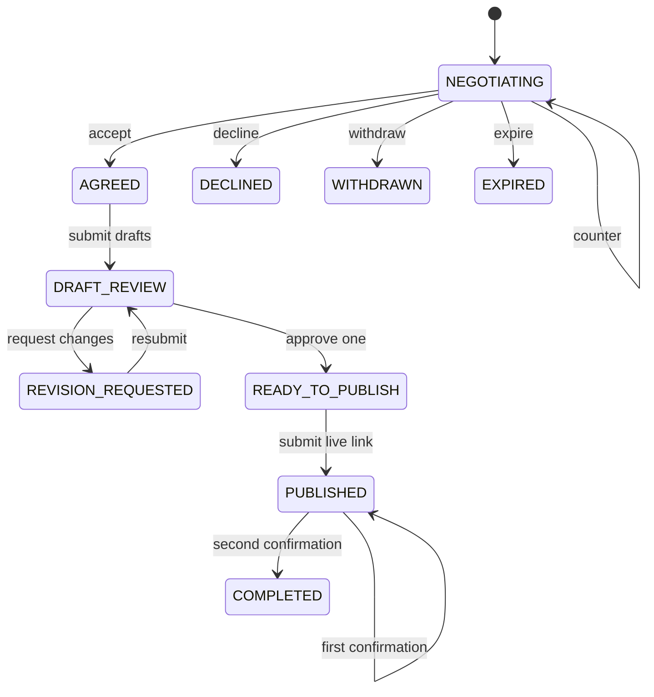

# Creator Sponsorship Marketplace

## Backend implementation specification

**Audience:** Backend coding agent. This document owns the shared API contract. Implement it alongside `Creator_Sponsorship_Frontend_Spec.md`.  
**Goal:** A small brand can go from a campaign idea to a published sponsorship. A creator can set up a profile once and handle offers and approvals from a deal inbox.  
**Demo promise:** You.com finds live evidence about an opted-in creator. The brand can see why the creator fits and get a suggested video angle, then complete a sponsorship with simulated payment.

## 1. Release scope

| Area | Hackathon requirements |
| --- | --- |
| Marketplace | Private, authenticated directory of creators who published a profile. Brands can browse, open a profile, and send a direct offer. |
| Creator onboarding | One public YouTube channel handle or URL, optional media-kit URL, profile and rate form, You.com enrichment, and creator review before publication. Interpret “connect” as adding a public profile URL for this release. |
| Campaigns | Brand describes a goal, picks a product, confirms an editable AI-generated brief and total budget, sees ranked creator matches, and sends individual offers. |
| Deals | One YouTube post per deal. In-app offer, counteroffer, agreement, one or two candidate draft videos per submission, approval, live URL, and confirmation by each participant. |
| Payments | Persisted simulation of hold, release, and refund. Always show “Simulated payment.” Make live checkout, payouts, and money movement unavailable in this build. |
| Disputes | Either party can raise a delivery issue. An admin reviews the deal and records the resolution. |
| Reporting | Show campaign spend, delivery status, scoped view and click targets, observed results, and underperformance. Performance signals have no effect on payment. |

Use one user per brand workspace and one profile per creator. Public-web lead generation, social OAuth, automatic posting, shipping and inventory, team seats, production financial processing, automatic view collection, automated payout decisions, and cross-platform expansion are future scope. The brand and creator can place practical arrangements such as access to a physical sample or a demo product in the offer brief. Start the demo with one niche, such as keyboards or desk accessories, and support other topics in the same form and matcher.

## 2. Roles, screens, and entry points

| Role | Screens and allowed actions |
| --- | --- |
| Brand | `/brand/creators`, `/brand/creators/[id]`, `/brand/products`, `/brand/campaigns`, `/brand/campaigns/[id]`, `/brand/deals`, `/deals/[id]`. Manage its own products and campaigns, view listed creators, send offers, respond to counters, approve drafts, review delivery, and see its reports. |
| Creator | `/creator/onboarding`, `/creator/profile`, `/creator/inbox`, `/deals/[id]`. Edit and list its own profile, run enrichment, respond to offers, submit draft alternatives and a live URL, and confirm completion. |
| Admin | `/admin/disputes`, `/admin/disputes/[id]`. View dispute evidence, review affected deals, and resolve them. Provision the role from a server-side seed or admin command. |

Use `/sign-in` and `/sign-up`, with a single role selected at signup. Verify email before enabling write actions in the deployed app. A first authenticated visit creates a matching role record idempotently. Never assign an admin role based on signup input or editable auth metadata. A user who tries to open the other participant’s unrelated deal receives a 404. Route the creator’s homepage to its inbox once onboarding is done. On mobile, put the next available action at the top of the deal and keep upload and review usable without a desktop.

### Brand product and campaign flow

1. Create a product with name, description, and optional HTTPS landing URL. The product form can open inline during campaign or direct-offer creation. Products are private to the brand until their snapshot is included in an offer.
2. Create a campaign with an existing product and a free-text brief. **Generate brief** calls the AI with the product name, product description, and campaign prompt. Show an editable form, with manual entry available on refusal, timeout, or incomplete output.
3. Confirm the reviewed fields and a positive total USD budget. The server persists the exact reviewed brief as the active campaign version. Generate matches only after confirmation. Active campaign edits create a new brief version and invalidate the displayed result set until matching reruns. Already-issued offers retain their own snapshots.
4. Each result card shows the creator, format, tags, rate range, available public counts or creator-reported reach, and one or two **Why this creator** reasons. Show source links. Add a clearly labeled **Suggested video angle** on demand or on opening a match. The brand can edit or remove it from the offer draft.
5. The brand selects a creator, reviews the offer, and explicitly sends it. No bulk sending. A direct offer follows the same flow with `campaign_id = null` and can start from any listed profile. A brand can close a campaign to new offers and acceptances once there are no pending negotiations. Agreed deals and reports stay accessible.

### Creator profile and inbox

- Required fields are display name, short bio, canonical YouTube profile URL, at least one reviewed topic and format, and opt-in to directory visibility. Optional fields are media-kit URL, timezone, language, creator-entered rate range, and creator-reported typical 7-day views. Apply lengths of 80 characters for name, 600 for bio, and 2,048 for URLs. Use up to eight topics and four formats.
- Use `DRAFT`, `LISTED`, and `HIDDEN` profile states. The creator can edit, hide, or relist explicitly. Hiding stops new discovery and offers, including offers from stale campaign results. It leaves existing offers and deals accessible. Public channel ownership is self-attested in the demo. Use wording like “Public evidence” for source facts and “Creator provided” for self-reported information.
- Inbox lists items that need a response first, then most recent activity. Provide `Needs action`, `In progress`, and `Closed` filters. A stable deep link returns to the deal after sign-in. Use a timeline with timestamp, actor, visible action, and safe note text.

## 3. You.com integration and evidence rules

### User experience

The **Find public profile evidence** button starts an asynchronous run. Display `Queued`, `Searching with You.com`, and a final state of `Ready`, `Partial results`, `No usable evidence`, or `Couldn’t fetch data`. The creator can continue entering profile fields during the run. The review shows suggested tags, source links, short evidence excerpts, optional count and observed date, and the option to accept or dismiss suggestions. The creator explicitly publishes the resulting profile. Refreshes create a new suggestion set and preserve the currently listed version until the creator approves updates.

### Runtime implementation

1. Normalize `@handle`, `youtube.com/@handle`, or a `/channel/UC…` URL into a canonical HTTPS identity. Strip trailing slash, tracking parameters, and URL fragments. Reject unrecognized profile paths or look-alike hosts. Enforce uniqueness of the active canonical identity across creators. Handle and channel-ID aliases may be linked when a public source establishes the mapping. Require a matching handle, channel ID, direct cross-link, or a creator-supplied page with an independently matching identity before attaching a claim. A display-name match alone is insufficient.
2. Use the You.com hosted MCP product server, `https://api.you.com/mcp?tools=you-search,you-extract`, with a server-held `YDC_API_KEY` in an authorization bearer header. Use an MCP Streamable HTTP client and the connected tool schemas. Provision a key for the deployed demo. The keyless server at `https://api.you.com/mcp/free` is suitable for an initial smoke test. Verify access by calling a search tool, then confirm the response contains an actual result. [You.com MCP server](https://you.com/docs/agents/mcp-server)
3. Run two searches in parallel with `count: 6`. Search for the exact handle or channel ID plus videos and descriptions on YouTube, then search for the same identifier with `media kit`, `sponsorship`, or `collaboration`. Search without the YouTube restriction for the second query. If needed, call `you-extract` on up to two matched public results or the creator’s supplied media-kit URL. Allow at most four tool calls per run. Set an 8-second timeout per call and a 30-second run deadline, including normalization. If a call fails, proceed with usable results. [You.com Search](https://you.com/docs/api-reference/search/v1-search) · [You.com Extract](https://you.com/docs/guides/extract)
4. Canonicalize and deduplicate result URLs. Normalize result records to `url`, `title`, `publicText`, `publishedAt | null`, `retrievedAt`, `identityMatch`, and `sourceType`. Clip inputs to 1,200 characters per result and 12,000 characters total. Keep the LLM in a schema-constrained extraction step. Treat every page as untrusted evidence. The model receives no secrets, can issue no follow-up tool calls, and can propose only claims that refer to supplied result IDs. The server validates identity, references, metric labels, numeric values, and quote overlap. For claims based on a public page, retain the shortest supporting text and a citation.
5. Save approved claims and short evidence excerpts, with freshness and provenance. Source priority is the creator’s own linked channel or media kit, a brand’s named collaboration page, then a corroborated secondary source. When equally credible counts disagree or the units are ambiguous, omit the headline number and keep the underlying sources available to review. Persist the qualification attached to approximate values, such as `12K`. Show retrieval time as “Found on” and any source date separately. A retrieval date does not establish when a count was measured. Display public provider data only where its terms permit, and use creator-provided rates and reach for decisions that require those values.
6. Reuse the latest result when the same creator requests an unchanged URL set within 24 hours. A rate limit allows one in-flight run and three new runs per creator per day. Store sanitized elapsed time, call count, response status, and evidence count. The worker must discard a stale result if the creator changes the source URLs while a run is in progress. The profile remains editable during provider outages.

| Claim | Rules |
| --- | --- |
| Topics and formats | Infer short labels from identifiable posts or descriptions. Each suggested label has at least one supporting source. Creators can add their own labels with creator-provided provenance. |
| Previous collaboration | Use a source that explicitly names the relationship. A product appearing in a video is evidence of coverage only. |
| Public metric | Store the specific metric and object, such as views for a particular video or subscribers for a channel. Put uncertain or unavailable metrics in the no-data state. |
| Audience demographics | Display only an explicit creator-supplied aggregate with a date and source. Leave this field unavailable in the default UI. |
| Rate and expected clicks | Use the creator-approved rate range. A published media kit can prefill it. Show forecast clicks as unavailable for real profiles in this release. Clearly label illustrative click ranges on sample profiles. |

Dev and test may use deterministic provider fixtures. In the deployed demo, distinguish `LIVE`, `CACHED`, and `SAMPLE` evidence. If live enrichment is unavailable, show a visible fallback to sample or creator-entered data. Show at least one real You.com call from inside the app for the sponsor demo when the provider is available.

## 4. Campaign brief and ranking

| Field | Rule |
| --- | --- |
| `title`, `goal`, `objective` | Title 1–80 characters, goal 1–1,500 characters, objective one of `AWARENESS`, `TRAFFIC`, `SALES`, `CONTENT`. |
| `topics`, `formats` | Require at least one topic. Accept up to eight unique values. Lowercase and hyphenate topic slugs, trimming whitespace, and show readable names in the UI. Formats use `REVIEW`, `DEMO`, `TUTORIAL`, `UNBOXING`, `COMPARISON`, `STORY`, or `OTHER`. An empty format list means open to any supported style. |
| `talkingPoints`, `restrictions` | Up to six short items each, 240 characters per item. They guide review and copy into an offer for brand editing. Include an explicit sponsorship disclosure field in the offer. |
| `budgetCents`, `preferredMaxPerPostCents` | Positive total USD budget, typed and confirmed by the brand. Optional maximum per post is a matching preference at or below the total. Store cents as integers. |
| `defaultViewTarget`, `defaultClickTarget` | Optional positive integers for the first seven days. Default inputs for new offers. Brands can leave them unset. |

The AI may suggest campaign text, topics, formats, and talking points. Leave budgets and numeric performance targets empty unless the input states them explicitly. Never activate a campaign from model output. Use a structured model output and validate server-side with Zod. Keep one shared schema for AI parsing, manual entry, and persistence. [Structured Outputs](https://developers.openai.com/api/docs/guides/structured-outputs)

### Match deterministically

Eligible candidates are `LISTED` registered creators with accepted platform fields. Calculate `topicMatchPct = round(100 × matching requested topic count / requested topic count)`. Use exact normalized slugs plus a versioned synonym map, for example `custom-keyboards → mechanical-keyboards`. Calculate `formatMatch` as `1` when the requested format list is empty or overlaps the creator’s reviewed formats, else `0`. For the campaign ranking, omit candidates with zero matching topics and show an explicit empty state when applicable. Let brands edit the brief or open the unfiltered directory.

Sort by the following keys in order. Add fixture tests showing a highly relevant low-reach creator ranks ahead of an unrelated high-reach profile.

1. Topic match percentage, descending.
2. Format match, descending.
3. Rate fit, descending. If a price preference exists, score `2` when the creator’s minimum is within it, `1` when the rate is unknown, and `0` when the minimum exceeds it. Compare against the lower of the preference and remaining budget. Without a preference, use remaining budget. An unaffordable or unknown rate does not suppress a candidate. Disable send if the proposed offer is unaffordable.
4. Creator-reported typical seven-day views, descending, with unknown last. Never substitute logged public counts, forecasts, or sample stats for this slot on live profiles.
5. Creator UUID ascending to break ties.

Generate fit reasons from the actual matching labels and their approved evidence. Mark creator-supplied labels as such. On request, use a short structured model call to propose one hook and one sentence of execution grounded in the product information, brief, and creator formats. Store the idea against the brief version and profile version. Fallback example for a comparison creator is “Show a before-and-after comparison and invite viewers to choose which result they prefer.” For a sound-test creator, an angle could be “Let viewers hear the difference between the stock keyboard and the upgraded build.” A suggestion remains optional and the creator decides how to execute.

## 5. Offer and deal rules

### Agreement terms

Every proposal is an immutable full copy of the terms. Accepting the latest proposal creates the agreement on the same deal ID. Store price in USD cents, campaign ID or null, creator and brand IDs, product ID and name/description/landing URL snapshot, platform `YOUTUBE`, one approved delivery format, short brief, optionally an angle, talking points, restrictions, disclosure instructions, draft deadline, publication deadline, and optional seven-day view and click targets. Limit the brief to 2,000 characters, angle and disclosure to 500 each, and amounts to 1–10,000,000 cents. Validate future UTC timestamps with `draftDueAt < publishDueAt` on send and counter. On accept, both deadlines must still be in the future. If a draft deadline passed, the recipient can counter with updated dates before the proposal expires.

The brand starts the offer. Only the recipient of the latest proposal can accept, decline, or counter it. Counters may change amount, deadlines, and suggested angle. Product, platform, format, requirements, and advisory targets remain fixed for a negotiation. A material change requires a new offer. Either party can decline when it is their turn. The original brand can withdraw a negotiation at any time before agreement. Each proposal expires after seven days. A counter resets that clock. Expiry is enforced by the API clock even if background maintenance is late. Limit to one pending negotiation per brand and creator per context, where context is the campaign ID or `direct` plus product ID. Allow independent agreements and campaigns for the same creator.

### State vocabulary

Each deal has exactly one status and one separate simulated payment status. Return both, plus actions computed for the viewer. Waiting for approval, publication, or confirmation always has a visible responsible party. Use server time and transactions for all state changes.



| Action | Who and when | Result |
| --- | --- | --- |
| `COUNTER`, `DECLINE`, `WITHDRAW` | As specified above in `NEGOTIATING`. | Adds proposal or closes negotiation. Payment remains `NONE`. |
| `ACCEPT` | Recipient of latest open proposal. | Atomically creates agreement and budget reservation where applicable. Deal becomes `AGREED` and payment remains `NONE`. |
| `SUBMIT_DRAFTS` | Creator in `AGREED` or `REVISION_REQUESTED`. | Adds one batch of one or two ready uploaded MP4s. Deal becomes `DRAFT_REVIEW`. |
| `REQUEST_CHANGES` | Brand in `DRAFT_REVIEW`. | Requires a 1–1,000 character reason. Deal becomes `REVISION_REQUESTED`. Creator can submit up to two more batches, for a maximum of three batches total. On the last batch the brand can approve or report an issue. |
| `APPROVE_DRAFT` | Brand in `DRAFT_REVIEW`, one asset from latest batch. | Freezes approved asset, sets `READY_TO_PUBLISH`, and writes one payment transition `NONE → HELD`. |
| `SUBMIT_PUBLICATION` | Creator in `READY_TO_PUBLISH`. | Requires a supported public YouTube URL and true attestation that this is the approved sponsored post and requirements were followed. Derive unique `videoId` within the deal and store canonical URL. Set `publishedAt` to the creator-reported time, constrained between draft approval and server time. Deal becomes `PUBLISHED`. The brand verifies delivery manually. |
| `CONFIRM_DELIVERY` | Either participant in `PUBLISHED`. | Record each party’s confirmation once. On the second confirmation, set `COMPLETED` and payment `RELEASED` in one transaction. Record the brand was satisfied with delivery through its confirmation. |
| `REPORT_ISSUE` | Either participant in `AGREED`, `DRAFT_REVIEW`, `REVISION_REQUESTED`, `READY_TO_PUBLISH`, or `PUBLISHED`. | Save one dispute and its prior deal status, reason code, and description. Set `DISPUTED`. The existing payment state stays `NONE` or `HELD`. |
| `RESUME_DEAL` | Admin in `DISPUTED`. | Record reason and restore the prior deal status. Preserve previous asset, link, and confirmations. Allows a rejected dispute to return to normal flow. |
| `CANCEL_DEAL` | Admin in `DISPUTED` while payment is `NONE`. | End as `CANCELLED`, release budget reservation, and keep payment `NONE`. |
| `RELEASE_PAYMENT` | Admin in `DISPUTED` while payment is `HELD`. | End as `COMPLETED`, mark payment `RELEASED`, and save reason. Admin explicitly overrides missing delivery confirmations. |
| `REFUND_PAYMENT` | Admin in `DISPUTED` while payment is `HELD`. | End as `REFUNDED`, mark payment `REFUNDED`, free the reservation, and save reason. |

`COMPLETED`, `REFUNDED`, `CANCELLED`, `DECLINED`, `WITHDRAWN`, and `EXPIRED` are terminal. Admin resolutions require a 1–1,000 character explanation and retain history even when a resumed deal later opens another dispute. Allowed issue codes are `MISSED_DEADLINE`, `CONTENT_MISMATCH`, `MISSING_DISCLOSURE`, `INVALID_PUBLICATION`, `UNRESPONSIVE_PARTY`, and `OTHER`. Present views and clicks as reporting issues. An `OTHER` dispute that describes performance alone should be resumed by the admin. Support manual review for a confirmed delivery problem before completion. A post changed or removed after terminal completion is logged through the project's manual support channel in this release.

Once a deal is agreed, deadlines are reminders and issue triggers. Late submissions are allowed and marked as late. Use a worker to notify the responsible party at the deadline, and send one reminder after 48 hours waiting for draft approval or publication confirmation. No automatic cancellation or payment release. In a dispute, pause action reminders and recalculate eligibility when resumed. Already-sent reminders stay recorded. A publication URL typo can be handled by admin cancellation or refund in the hackathon release. Provide a confirmation screen before submitting to reduce this failure. Support YouTube `/watch?v=`, `/shorts/`, and `youtu.be/` URLs with the canonical 11-character video ID. Preserve the one submitted link in the audit history.

### Concurrent budget enforcement and idempotency

For each campaign derive `committedCents` as the sum of active reservations (agreed deals, including disputes), `spentCents` as released reservations, and `remainingCents = budgetCents - committedCents - spentCents`. Direct deals have no campaign reservation. Sending a proposal associated with a campaign requires an amount at or below current remaining budget. Pending proposals create no reservation. A counter may exceed the current remainder, but acceptance must validate available budget. Reduction of campaign cap below committed plus spent is rejected. A held simulation remains an active reservation. Release moves it to spent, and cancellation or refund voids it and frees budget.

Use PostgreSQL transactions. For all campaign-linked operations that can write budget or deal status, lock the campaign row first and the deal row second, then validate ownership, action, deadline, current version, and balance. Lock the single deal for direct transactions. Use unique constraints on `deal_id` for reservation, hold/release/refund event types, and `(deal_id, user_id)` for confirmations. Accept and write reservation plus audit event in one transaction. Write notifications to a durable outbox in the same transaction. Handle campaign edits and close with the same first lock. If a writer reads the deal to identify its campaign before acquiring the locks, re-read under lock and use that state for all decisions.

Deal mutations use `Idempotency-Key` and `expectedVersion`. Scope the key to actor and operation. Persist a request fingerprint and safe successful response. A repeat with the same payload returns the original successful response, including after version changes. A key reused for another payload returns `409 IDEMPOTENCY_CONFLICT`. Serialize simultaneous uses of the same key using a transaction-scoped database lock or unique claim. A stale version returns `409 STALE_DEAL`. Re-fetch the deal before offering the next action. A failed transaction writes neither state nor a successful replay response.

## 6. Campaign analytics and underperformance

Performance targets are advisory seven-day goals set by the brand and visible to the creator before agreement. The accepted deal snapshots them. Targets, forecasts, and measured counts occupy separate fields. Copy the accepted targets to the deal report even if the brand later changes campaign defaults. The deal state machine has no dependency on this report.

| Metric | Hackathon measurement |
| --- | --- |
| Views | Creator or brand submits an aggregate view count, a measurement timestamp, and a source note. Accept only times from the published timestamp through server time. Keep immutable snapshots tagged `SELF_REPORTED` with role and time. An edited value creates a new snapshot. Use the latest measurement within the seven-day window, breaking ties by server creation time. Prefer no-data display when there is no qualifying observation. Any is a manual report, including where the value was copied from the public video. |
| Clicks | Offer an optional first-party tracked URL for deals with an HTTPS product landing URL. Make the link available to the creator after draft approval so it can be included in the post. The server resolves a random 128-bit token to the frozen product landing URL and issues a 302. Reject invalid tokens, credentials in URLs, redirects to the app’s own tracking route, and loopback or private host/IP literals during product input. Do not accept a redirect destination in the query string. |
| Counted click | Count GET traffic from recognized, eligible links only. Check the request for known crawler or preview user agents and prefetch headers, skip non-GET, and use a random per-browser session cookie, salted server-side token hash, and time bucket to suppress repeats within a UTC hour. Use one insert per `(deal_id, visitor_hour_hash, hour_bucket)`. Count clicks during `[publishedAt, publishedAt + 7 days)`. A click registered after draft approval but before submission can count if its timestamp falls inside this window. Report “Tracked clicks” rather than unique people. Drop raw IP and full user agent from analytics storage. |

Verify that the creator explicitly indicates whether the tracking URL was included in the post. During publication confirmation the brand can send a content issue if the accepted requirements included the link and it is absent or incorrect. Low or zero click counts with a working required link are performance outcomes. For targets, use the following display states:

| Condition | Status |
| --- | --- |
| No target | `NO_TARGET` |
| Deal has no publication timestamp, or measurement window is still open | `PENDING`. Show available observations as provisional. |
| Window closed and qualifying data is missing, or click link wasn’t added | `INSUFFICIENT_DATA` |
| Window closed and a qualifying value meets or exceeds the target | `MET` |
| Window closed and a qualifying value is below the target | `BELOW_TARGET` |

A view snapshot qualifies for the final result only if taken in the last 24 hours of the seven-day window, including its end. Earlier snapshots remain visible as provisional. Send a prompt at the start of that last day and accept a later submission of an aggregate with a qualifying historical timestamp. Once actuals are present, display the observed-to-target ratio and percent shortfall, for example `420 / 600 tracked clicks · 30% below target`. The brand can add a private campaign note. With both actual and target show the message “Use this result to refine the next brief.” Never use one low result to demote a creator. Across multiple future campaigns, manually reviewed seven-day results could inform calibrated estimates, with sample size and metric source disclosed. Include sample result fixtures for underperformance and missing data. Keep sample events and reports out of live totals.

## 7. Technical defaults and storage

Use one TypeScript repository with Next.js App Router for UI and Route Handlers, PostgreSQL for domain records, Supabase Auth and private Supabase Storage, and a small Node worker for enrichment, outbox delivery, and reminders. Deploy web and worker from the same commit. Use PostgreSQL parameterized queries and checked-in SQL migrations. Node and dependency versions are pinned in the repository. Use an OpenAI Responses API model with structured output support for enrichment extraction, brief writing, and optional angles. Read the model from `AI_MODEL`. Allow `AI_MODE=fixture` in local or seeded demo environments. Choose the configured model with a successful structured-output smoke test. You.com live search uses a separate provider setting. Use Resend for optional email and provide a deterministic logged-mail sink in demo mode.

### Data model and indexes

All IDs are UUIDs unless specified. Use `timestamptz`, UTC timestamps in the API, and database checks for bounds and fixed enums. Foreign keys reference their declared owners. Use text enums with stable API strings. Snapshot JSONB values live beside the normalized owner and status fields. Validate snapshots against the shared runtime schema before writing. An application database role and server auth checks protect all records. Revoke client access and enable RLS on application tables where they are exposed to the hosted API. Keep signed URL generation and the storage secret server-side.

| Record | Required fields and constraints |
| --- | --- |
| `users`, `brand_profiles` | Auth user ID, role, display name, creation time. Brand profile has owner ID and brand name. Unique owner. Admin provisioning is privileged. |
| `creator_profiles`, `creator_profile_versions` | User ID, visibility, self-attested canonical social key, current version, latest suggestion run, profile editor fields. Unique active social key and `(creator_id, version)`. Published version holds approved tags, creator-entered claims, evidence IDs, and rates. Editable and listed versions may differ. |
| `enrichment_runs`, `evidence` | Creator ID, normalized input hash, stage, mode, timeout/retry metadata, metrics, short provider failure code. Evidence has source URL, title, exact field/type, value, date if available, retrieval time, source kind, run ID, and supporting excerpt. Index `(creator_id, created_at desc)`. |
| `products`, `campaigns`, `campaign_versions` | Brand ID, current version, product pointer, `DRAFT`, `ACTIVE` or `CLOSED` status, current budget, approved brief fields and source prompt. Use optimistic version checks on edits. Campaign version history is append-only. Index by `(brand_id, updated_at desc)`. |
| `match_runs`, `match_results` | Campaign and brief versions, result snapshot with ranking tuple, creator/profile version, cited reasons and optional suggested angle. Persist the latest run for a campaign version and allow explicit recompute. Recheck active visibility before returning or using a stored result. |
| `deals`, `proposals`, `agreements` | Deal binds brand, creator, optional campaign, and product. It has status, payment status, version, latest proposal, active draft batch, approval and publication timestamps, and optional issue pointer. Append-only proposals contain author, expiry, and terms. Unique `(deal_id, revision)`. Agreement unique by deal ID, copies accepted terms and proposal ID. Enforce one active negotiation per context with a partial unique index. Index both inbox ownership columns by updated time. |
| `uploads`, `draft_batches`, `draft_assets` | Upload belongs to creator and deal, includes unique server-generated object path, bytes, state `ISSUED`, `READY`, or `ATTACHED`, and expiry. Batch stores round number (unique per deal) and ordered draft assets. Each upload attaches once. Store approved asset on deal. |
| `publications`, `confirmations` | At most one publication per deal, canonical URL, declared publication timestamp, attestation, link-use boolean, and submitter. Confirmations unique per deal and user with timestamp. |
| `budget_reservations`, `payment_events` | Reservation unique per deal, campaign ID, cents, `ACTIVE`, `SPENT`, or `VOID`. Payment events append-only with amount and event reason, unique `(deal_id, event_type)`. Index reservation campaign and state. |
| `disputes`, `deal_events` | Dispute records opener, code, note, prior state, resolution, admin, and timestamps. A partial index permits one open dispute per deal. Append-only deal events have sequence unique per deal, actor, action, time, and UI-safe metadata. |
| `tracked_links`, `click_events`, `view_observations`, `campaign_notes` | Link has protected random token, unique deal ID, fixed destination, and active eligibility; click stores salted visitor/time data; view observation stores time, value, note, and role; notes belong to a brand and a campaign or to a direct deal. Restrict sample counts to sample reports. |
| `notifications`, `outbox_jobs`, `idempotency_keys` | User and resource IDs, event type, stable deduplication key, payload with safe IDs, status, attempts, lease or delivery times. Notifications carry `read_at`. Store idempotency keys with actor, operation, key, request hash and result. |

### Private video upload and review

`POST /deals/{id}/uploads` verifies that the user is the acting creator and the deal accepts draft submissions. It assigns an opaque storage path under the deal namespace and returns the signed upload fields. Accept MP4 only, max 20 MiB per file and two assets per batch. Limit to six outstanding uploads per deal and 24 hours to attach an uploaded asset. Enforce upload limits in the private bucket and on the server. On completion verify the object exists, content type and length match the claim, and its first bytes have a valid MP4 signature. Cap inspection to the bytes needed, and use file size limits even when content-length is absent. Treat MIME as advisory until inspected. Issue playback URLs only after checking participant or dispute-admin access for the asset. Use five-minute playback URLs and renew when needed. Delete unused expired uploads. Prevent changes to attached assets with unique object keys and disabled upsert. Use compression instructions in the UI and a browser-playable MP4 fixture for testing. [Private buckets](https://supabase.com/docs/guides/storage/buckets/fundamentals) · [Signed uploads](https://supabase.com/docs/reference/javascript/storage-from-createsigneduploadurl)

### Worker and notification rules

Claim database jobs using `FOR UPDATE SKIP LOCKED` and a bounded lease. Make handlers idempotent and allow stale leases to expire. Retry transient outages at most twice after the first attempt with a short exponential delay. Expire proposals and create deadline reminders every minute. Creating inbox and outbox records is atomic with deal activity. Send the next responsible user an inbox item for offer, counter, acceptance, draft review, revision, approval, publication, delivery confirmation where pending, issue, or resolution. Decline, withdrawal, expiry, and completed payments notify the affected participants. Email active tasks and issue/resolution events to the relevant user, using a safe subject and a link to the app. Email failures do not roll back a deal. Use the notification ID for provider idempotency and bound provider retries to less than 24 hours. Do not include agreement notes, video URLs, or tokens in email. In demo mode, write an email log unless sending is explicitly configured. [Resend idempotency](https://resend.com/docs/dashboard/emails/idempotency-keys)

## 8. Shared API contract

Prefix all JSON endpoints with `/api/v1`. Put runtime schemas and inferred TypeScript types under `src/shared/contracts`. Export an OpenAPI document and example payloads from the same shapes. Frontend mocks use those same types. Prioritize freezing this contract before independent implementation. Return `application/json` with `{ "data": ... }` on success or `{ "error": { "code": "...", "message": "...", "fields": { "fieldName": "..." } } }` on failure. `fields` is optional. Format timestamps as ISO 8601 UTC (`Z`), prices in USD cents, IDs as strings, and absent known fields as `null`. Lists return `{ items, nextCursor }` with opaque `cursor`, `limit` of 1–50, and default 20. Require server-authenticated requests, same-origin policy on browser writes, and no-cache headers for private resources. Return 201 for creates, 202 for queued enrichment, and 200 otherwise. The public redirect at `/r/{token}` is outside this JSON convention.

| Method and route | Request and response item |
| --- | --- |
| `GET /me`, `POST /onboarding` | Read `{ id, role, displayName, profileReady }`. Create app role once from `{ role: BRAND or CREATOR, displayName }`. Use session ID only. |
| `GET /creators`, `GET /creators/{id}` | Brand directory `q`, `topic`, `format`, cursor. Return listed `CreatorCard` objects or a detailed card with source evidence. Directory sorts by display name and ID. |
| `GET /creator/profile`, `PUT /creator/profile` | Fetch/save caller’s draft. Input includes `expectedVersion`, editable values, approved evidence IDs, and selected tags. Return profile draft, version, visibility, and listed version. |
| `POST /creator/profile/visibility` | `{ visibility: LISTED or HIDDEN, expectedVersion }`. Validate required fields and copy current draft into listed version on `LISTED`. |
| `POST /creator/enrichment`, `GET /creator/enrichment/{id}` | Start or reuse run for saved draft URLs, then get `{ id, status, mode, evidence, suggestions, retrievedAt, errorCode }`. `status` is `QUEUED`, `RUNNING`, `READY`, `PARTIAL`, `EMPTY`, `FAILED`, or `STALE`. |
| `GET /products`, `POST /products`, `PATCH /products/{id}` | Brand only. Create or edit `{ name, description, landingUrl }`. Return `{ id, name, description, landingUrl, createdAt, updatedAt }`. |
| `POST /campaigns/parse` | `{ productId, prompt }` → fields from §4 with `budgetCents` nullable until confirmed by the brand. Prompt max 3,000 characters. On provider/schema failure return a typed error and editable form stays open. |
| `GET /campaigns`, `POST /campaigns`, `GET /campaigns/{id}`, `PATCH /campaigns/{id}` | Create/update confirmed campaign from `{ productId, sourcePrompt, brief, budgetCents, preferredMaxPerPostCents, defaultViewTarget, defaultClickTarget, expectedVersion? }`. For saving a partial campaign retain only brand-owned product and draft input until confirmation. Use `confirm: true` to activate. Close with `{ status: CLOSED, expectedVersion }`. Return campaign details and budget summary. |
| `POST /campaigns/{id}/matches`, `GET /campaigns/{id}/matches`, `POST /campaigns/{id}/matches/{creatorId}/angle` | Create/reuse matches for `{ expectedVersion }`. Read latest eligible result list. Generate angle using current campaign and profile versions. Return `MatchCard` or `{ angle, profileVersion, campaignVersion }`. |
| `POST /deals`, `GET /deals`, `GET /deals/{id}` | Create from `{ creatorId, productId, campaignId, terms }` with idempotency key. List viewer’s current deals by inbox filter. Return `Deal`. |
| `POST /deals/{id}/actions` | `{ action, expectedVersion, ...actionFields }` with `Idempotency-Key`. Actor comes from session. Return `Deal`. |
| `POST /deals/{id}/uploads`, `POST /deals/{id}/uploads/{uploadId}/complete`, `GET /deals/{id}/assets/{assetId}/playback` | Issue from `{ sizeBytes, contentType, fileName }` → `{ uploadId, path, token, expiresAt }`. Complete → `{ uploadId, status }`. Playback → `{ url, expiresAt }`. |
| `GET /admin/disputes`, `GET /admin/disputes/{id}` | Resolve via the same deal action endpoint and admin authorization. Include `{ id, dealId, openedAt, openedByRole, code, reason, priorStatus, resolvedAt, resolution, resolutionReason }` and deal evidence on detail. |
| `GET /campaigns/{id}/report`, `GET /deals/{id}/report`, `POST /deals/{id}/view-observations` | Summary with spend, count by deal status, eligible tracked-click totals, and per-deal `DealReport`. Observation request `{ views, measuredAt, sourceNote }` with idempotency key. Campaign report brand only, individual report both parties. |
| `POST /campaigns/{id}/notes`, `POST /deals/{id}/notes` | Brand-only private note `{ text }`, up to 1,000 characters. Show campaign notes on its report and direct notes on its deal report. |
| `GET /notifications`, `POST /notifications/{id}/read` | Owner only, paginated. Return `{ id, type, href, createdAt, readAt }`. Mark read idempotently. |

**Shared shapes.** Use the following fields as the minimum stable contract. Where a nested field is marked nullable, render the empty state. `POST /campaigns/parse` returns `{ brief, budgetCents, preferredMaxPerPostCents, defaultViewTarget, defaultClickTarget }`. `brief` uses the fields in §4 through `restrictions`, leaving numeric fields at the top level. For a campaign draft, numeric fields and `brief` may be null. A confirm request requires a complete brief and positive budget. Detail and list items return `Campaign` below, with `dealCount` counting all linked deal records and `budget` null before a positive cap is saved. Match and dispute listing use the standard pagination envelope. Deal listing accepts `filter=needs_action|in_progress|closed` and optional `campaignId` for the owning brand.

```ts
type Evidence = { id: string; url: string; title: string; excerpt: string;
  retrievedAt: string; publishedAt: string | null; kind: 'PUBLIC' | 'CREATOR' | 'SAMPLE' }
type Label = { value: string; origin: 'PUBLIC' | 'CREATOR' | 'SAMPLE'; evidenceIds: string[] }
type Rate = { minCents: number; maxCents: number }
type Metric = { label: string; value: number; approximate: boolean; subject: string;
  measuredAt: string | null; evidenceId: string | null; source: 'PUBLIC' | 'SELF_REPORTED' | 'SAMPLE' }
type CreatorCard = { id: string; displayName: string; bio: string; profileUrl: string;
  topics: Label[]; formats: Label[]; rate: Rate | null; typical7dViews: number | null;
  publicMetrics: Metric[]; evidence: Evidence[]; dataMode: 'LIVE' | 'CACHED' | 'SELF_REPORTED' | 'SAMPLE';
  expectedClicks: { low: number; high: number; isSample: true } | null; profileVersion: number }
type MatchCard = { creator: CreatorCard; topicMatchPct: number; formatMatch: boolean;
  rateFit: 'WITHIN_PREFERENCE' | 'UNKNOWN' | 'ABOVE_PREFERENCE';
  reasons: { text: string; evidenceIds: string[] }[]; angle: string | null; campaignVersion: number }
type Budget = { budgetCents: number; committedCents: number; spentCents: number; remainingCents: number }
type Brief = { title: string; goal: string; objective: 'AWARENESS' | 'TRAFFIC' | 'SALES' | 'CONTENT';
  topics: string[]; formats: string[]; talkingPoints: string[]; restrictions: string[] }
type Campaign = { id: string; productId: string; sourcePrompt: string; version: number;
  status: 'DRAFT' | 'ACTIVE' | 'CLOSED'; brief: Brief | null; budget: Budget | null;
  preferredMaxPerPostCents: number | null; defaultViewTarget: number | null;
  defaultClickTarget: number | null; dealCount: number; updatedAt: string }
type TermsInput = { amountCents: number; format: string; brief: string; angle: string | null;
  talkingPoints: string[]; restrictions: string[]; disclosure: string;
  draftDueAt: string; publishDueAt: string; viewTarget: number | null; clickTarget: number | null;
  trackingLinkRequired: boolean }
type Terms = TermsInput & { currency: 'USD'; platform: 'YOUTUBE';
  product: { id: string; name: string; description: string; landingUrl: string | null } }
type Proposal = { id: string; revision: number; authorRole: 'BRAND' | 'CREATOR';
  expiresAt: string; createdAt: string; terms: Terms }
type DraftBatch = { id: string; round: number; submittedAt: string;
  assets: { id: string; label: string; sizeBytes: number }[] }
type Publication = { url: string; videoId: string; publishedAt: string; trackingLinkIncluded: boolean }
type MetricResult = { target: number | null; actual: number | null; measuredAt: string | null;
  source: 'SELF_REPORTED' | 'TRACKED' | 'SAMPLE' | null;
  status: 'NO_TARGET' | 'PENDING' | 'INSUFFICIENT_DATA' | 'MET' | 'BELOW_TARGET' }
type PrivateNote = { id: string; text: string; createdAt: string }
type DealStatus = 'NEGOTIATING' | 'AGREED' | 'DRAFT_REVIEW' | 'REVISION_REQUESTED' |
  'READY_TO_PUBLISH' | 'PUBLISHED' | 'DISPUTED' | 'COMPLETED' | 'REFUNDED' |
  'CANCELLED' | 'DECLINED' | 'WITHDRAWN' | 'EXPIRED'
type PaymentStatus = 'NONE' | 'HELD' | 'RELEASED' | 'REFUNDED'
type DealReport = { dealId: string; status: DealStatus; windowStart: string | null;
  windowEnd: string | null; views: MetricResult; clicks: MetricResult; sample: boolean;
  trackingLinkIncluded: boolean | null; notes: PrivateNote[] }
type CampaignReport = { campaignId: string; budget: Budget;
  countsByStatus: Partial<Record<DealStatus, number>>; agreedCount: number;
  publishedCount: number; completedCount: number; trackedClicks: number;
  deals: { items: DealReport[]; nextCursor: string | null }; notes: PrivateNote[] }
```

`Deal` contains `id`, `version`, `status`, `paymentStatus`, `brand`, `creator`, `campaignId`, `budget`, `latestProposal`, `agreement`, `draftBatches`, `approvedAssetId`, `publication`, `confirmations`, `trackingUrl`, `dispute`, `nextActionRole`, `availableActions`, `timeline`, `createdAt`, `updatedAt`, and `isOverdue`. `brand` and `creator` are `{ id, displayName }`. `budget` uses `Budget` for the viewing campaign owner and null for other viewers. `agreement` is nullable or `{ proposalId, acceptedAt, terms }`. `confirmations` is an array of `{ role, confirmedAt }`. `timeline` includes `{ id, actorRole, action, createdAt, note }`, with system actions using `SYSTEM` for `actorRole`. `trackingUrl`, `approvedAssetId`, `publication`, `dispute`, and `nextActionRole` can be null. For publication confirmation, both parties may have a next action. Set `nextActionRole` to null until exactly one confirmation remains. The actionable UI uses `availableActions` server-side eligibility for the viewer. `agreedCount` and `publishedCount` in reports count deals with the corresponding historical milestones. `completedCount` counts `COMPLETED`. Private report notes are returned only to their brand owner.

| `actionFields` | Fields besides `action` and `expectedVersion` |
| --- | --- |
| `ACCEPT`, `DECLINE` | `proposalId` |
| `COUNTER` | `proposalId`, `amountCents`, `draftDueAt`, `publishDueAt`, `angle` |
| `SUBMIT_DRAFTS` | `uploadIds` array of one or two unique IDs |
| `REQUEST_CHANGES` | `reason` |
| `APPROVE_DRAFT` | `assetId` |
| `SUBMIT_PUBLICATION` | `url`, `publishedAt`, `attested: true`, `trackingLinkIncluded` |
| `REPORT_ISSUE` | `code`, `reason` |
| `RESUME_DEAL`, `CANCEL_DEAL`, `RELEASE_PAYMENT`, `REFUND_PAYMENT` | `disputeId`, `reason` |
| `WITHDRAW`, `CONFIRM_DELIVERY` | No extra fields |

Validate 400 `VALIDATION_ERROR`, 401 `AUTH_REQUIRED`, 403 `FORBIDDEN` for a known role violation, and 404 `NOT_FOUND` for inaccessible resources. Use 409 for `STALE_DEAL`, `STALE_PROFILE`, `STALE_CAMPAIGN`, `BUDGET_EXCEEDED`, `ACTIVE_NEGOTIATION_EXISTS`, `INVALID_STATE`, `PROPOSAL_EXPIRED`, `IDEMPOTENCY_CONFLICT`, and `PROFILE_UNAVAILABLE`. A reply to an expired proposal must return `PROPOSAL_EXPIRED` even before the worker updates status. Use 413 for oversize, 429 `RATE_LIMITED`, and 503 `PROVIDER_UNAVAILABLE`. Rate-limit expensive endpoints per user and make tracking traffic best-effort on database failure, continuing to the known safe destination when lookup succeeds. Use short hop-by-hop request timeouts and redact keys, session tokens, storage signatures, and personal data from logs.

## 9. Build order, deployment, and acceptance

1. Freeze shared enums, endpoint schemas, sample JSON, and seed roles. Stand up auth redirects and an application database with migrations. Include `README` setup, `.env.example`, and commands to start web, worker, migrate, seed, and test. Have frontend develop against typed fixtures in parallel.
2. Build profile and product CRUD, query normalization, You.com worker, evidence review, campaign form/parse, matching, and angle. Verify with an opted-in YouTube handle for the live smoke test.
3. Implement offers first and exercise the hard cap with real concurrent transactions. Add drafts, approval and hold, publication, confirmations, and dispute outcomes. Exercise paths that use manual input in place of AI and social import.
4. Add inbox, tracked redirect, reports, sample scenarios, and email outbox. Integrate with frontend on a common seeded test environment. Deploy with HTTPS, use server-held provider credentials, ensure worker heartbeat, and perform a smoke test on web and worker revisions.

Local setup uses `DATABASE_URL`, `NEXT_PUBLIC_SUPABASE_URL`, `NEXT_PUBLIC_SUPABASE_PUBLISHABLE_KEY`, `SUPABASE_SERVICE_ROLE_KEY`, `APP_URL`, `YDC_API_KEY`, `OPENAI_API_KEY`, `AI_MODEL`, `AI_MODE`, `YDC_MODE`, `CLICK_HASH_SECRET`, `RESEND_API_KEY`, `EMAIL_FROM`, and `EMAIL_MODE`. Document each as required or optional for local fixture, live enrichment, and deployed email modes. Keep `APP_URL` fixed to the HTTPS deployment when building deep links and callback allowlists. A production startup check must refuse demo-only sign-in or seed mutations. Demo seeds are fake creators, fake brands, and placeholders where assets are needed, plus a team member’s opted-in live creator profile when given permission. Keep sample flags visible and isolate sample click and view counts from live records. Seed repeated runs idempotently with stable keys and separate `moderation` and `happy-path` deals.

| Area | Release acceptance |
| --- | --- |
| Sponsor flow | Creator submits a known handle. Server calls You.com from the deployed app. Creator accepts one sourced claim. Brand sees the claim explaining a match. Broken provider is handled with manual input or a labeled sample profile. |
| Direct and campaign offers | Both start paths persist a deal. A counter changes allowed terms only. Another participant’s stale accept gets a 409. Decline, withdrawal, and expiry stay terminal. |
| Budget | With $500 remaining and simultaneous $300 acceptances, at most one succeeds. Retrying a successful acceptance returns the same result. Refund/cancel frees exact cents. Release leaves spend counted. Lowering the cap below committed plus spent fails. |
| Drafts and posting | Upload one or two drafts, request revision, then approve exactly one from the latest batch. Approve twice yields one hold. Outsiders cannot view drafts. One party confirming leaves funds held, and second confirmation releases once. |
| Issues | Open a delivery dispute with a held payment. Participant actions pause. Admin can resume with reason or resolve the issue with release/refund. A pre-hold cancellation releases its reservation. Evidence and audit history survive all paths. |
| Reporting | Show 420 tracked clicks against a 600-click target as 30% below target after the window. Missing tracking link and absent qualifying views show insufficient data. Reporting changes never affect the payment table. Exercise excluded bot, repeated, and out-of-window traffic. |
| Access and resilience | Try cross-account reads and writes, role escalation, file tampering, forged state transitions, superseded evidence, and stale brief matches. The API guards every case. Reloading the app restores state. Email failures do not roll back successful deal actions. |

**Public demo script:** Creator imports YouTube evidence and publishes profile → brand drafts “Promote this quiet mechanical keyboard” with a $600 campaign budget → brand reviews and runs matching → app shows a sourced sound-test match and suggests a sound comparison → brand offers $250 → creator counters $300 → brand accepts and commits $300 → creator uploads two concepts → brand approves one, showing `Held` → creator submits the live link → both confirm, showing `Released` → show a separate completed sample deal whose report is `Below target`. Have a seeded disputed deal handy to show refund if time allows.

Production follow-up requires payment provider and dispute policy decisions covering funding timing, refunds, compliance, and any platform-specific data permissions. This spec implements the hackathon simulation and does not claim any live provider integration has already been executed.
